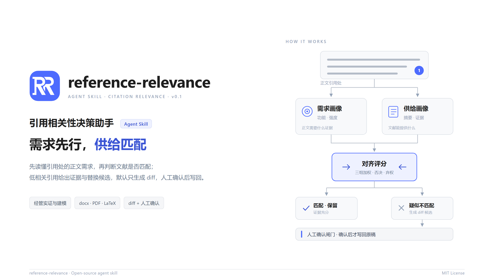

# reference-relevance



面向学术论文的引用相关性决策助手。先理解引用处的正文需求，再判断已引文献是否匹配；对低相关引用给出证据、建议动作与替换候选，默认只生成 diff，须人工确认后才写回原稿。

当前适用学科为经管实证与建模论文，支持 Word `.docx`、PDF、LaTeX，以及中文 GB/T 7714 与 APA 作者—年份制。

[English README](README_EN.md) · [参考文献与方法来源](REFERENCES.md)

## 功能

- 前置检查文献来源正确性：核验文献是否存在，以及作者、题名、期刊、年份、DOI、卷期页码是否与可信库一致；发现错误先修正，再进入相关性评估。
- 引用标记与功能分类由大模型直接完成：脚本只提取正文块与题录，大模型识别每处引用、逐条拆分多篇引用、判断引用功能；规则解析仅作兜底。
- 解析文档，抽取论断单元、引用位置、引用上下文与文献条目。
- 按「需求—供给」框架识别引用功能，逐条评估每位引用，不把同一括号内多篇文献共用一个判断。
- 多源获取真实摘要并交叉验真；中文来源单独路由，查不到时输出「无法核验」，不判定为文献不存在。
- 确定性评分、证据等级封顶、低置信度弃权；降级模式下不得直接判 D。
- 对低相关引用检索替换候选，生成 diff、备份与审计记录。

## 核心算法：如何判断引用是否相关

一句话概括：**先看正文需要什么，再看文献能提供什么，最后看两者是否对得上**。标题或摘要相似度只是其中一个线索，不是最终结论。

整个流程分成六个阶段。每个阶段都解决一个具体问题，也都有对应的脚本或模型在背后执行：

| 阶段 | 用户看到的结果 | 背后如何做 |
|---|---|---|
| 0. 来源正确性 | 文献是否存在、著录信息是否需要修正 | `verify_sources.py` 用 DOI / 题名向 Crossref、OpenAlex 查询，比对作者、题名、来源、年份、DOI、卷期页码；不一致时 `apply_source_fixes.py` 生成修正 diff |
| 1. 需求画像 | 每处引用要承担什么角色 | 按经管实证 / 建模两套功能模板分类，记录「理论依据 / 方法来源 / 数据测量 / 结果对比」等功能与「直接证据 / 间接背景」强度；一个括号内多篇引用逐条拆分 |
| 2. 供给画像 | 文献实际提供了什么 | `fetch_metadata.py` 取真实摘要并多源验真；NLI 模型判断文献结论对论断是支持、反驳还是中性提及；反驳方向不能作为支持性证据 |
| 3. 对齐评分 | A / B / C / D 四级判定 | `score_relevance.py` 对三组维度加权计算；原子化论断逐条核验；每级判定都附正文证据句和文献证据句 |
| 4. 替换候选 | 更合适的替代文献及理由 | `search_candidates.py` 先做 BM25 词法召回，`semantic_recall.py` 用 SPECTER 语义重排；候选按**与现有引用相同的评分标准**重排 |
| 5. 决策与写回 | diff、备份和人工确认闸门 | `apply_replacement.py` 默认只生成 diff；只有用户明确确认后才备份并写回；`calibrate.py` 可在有人工标注后校准置信度 |

### 用户需要知道的四个设计选择

1. **需求先于文献。** 先读懂正文想表达什么，再问文献是否供给得上。这样可以区分「合理的背景引用」和「主题相关但支撑不了论断的引用」。
2. **同一把尺子。** 评估现有引用和筛选替换候选使用同一套评分标准，避免「判它不合格，换上来的也不合格」。
3. **证据不够就不下结论。** 摘要级证据只能给出有限置信度；题名级证据强制转人工；中文来源查不到时输出「无法核验」而不是「文献不存在」。
4. **默认不代你改稿。** 所有替换都以 diff 呈现，写回需要显式确认，学术责任始终在作者。

### 实现参数（便于复核与调整）

| 模块 | 关键设置 |
|---|---|
| 来源核验 | 题名相似度阈值 0.6；来源相似度阈值 0.35；年份差超过 2 年判为字段错误；查不到只标 `fabricated_suspected` 或 `unverifiable_*`，不自动判编造 |
| 评分权重 | 需求对齐 0.40（功能 0.25 + 对象 0.15）；支撑性 0.40（命题支持 0.30 + 方向 0.10）；供给质量 0.20（证据强度 0.10 + 时效 0.05 + 一手性与可核验性 0.05） |
| 分级 | A ≥ 0.85；B 0.65–0.85；C 0.40–0.65；D < 0.40；方向为 REFUTE 时一票否决 |
| 证据上限 | `full_text` 1.0；`abstract_only` 0.6；`title_only` 0.45；`unverifiable` 0.3。低置信度一律弃权转人工 |
| NLI 判定 | `MoritzLaurer/DeBERTa-v3-base-mnli-fever-anli`，输出 SUPPORT / REFUTE / NEUTRAL 三态及概率；依赖缺失时输出 UNKNOWN 并由 agent 按量规推理 |
| 语义召回 | `sentence-transformers/allenai-specter`（SPECTER）双塔余弦重排；依赖缺失回退 BM25（k1=1.5, b=0.75）并标 `lexical_fallback` |
| 置信度校准 | numpy 实现 ECE、Brier Score、Platt Scaling、Isotonic Regression；不依赖 sklearn |
| 模型调用 | NLI 与语义召回为可选层；国内环境可设 `HF_ENDPOINT=https://hf-mirror.com`，依赖缺失时全程显式标注降级，不伪装成模型判定 |

更细的字段规范见 `references/rubric.md`，来源检查规则见 `references/source-verification.md`，脚本接口与降级行为见 `references/algorithms.md`，参考文献与方法来源见 [REFERENCES.md](REFERENCES.md)。

## 安装

### WorkBuddy skill

```powershell
Copy-Item -Recurse -Force .\reference-relevance "$env:USERPROFILE\.workbuddy\skills\reference-relevant"
```

### 其他 agent

本项目按 `SKILL.md` 组织，可被支持 skill / agentskills 约定或能读取 Markdown 指令的 agent 使用。常见安装位置如下；具体路径以所用 agent 的文档为准。

| Agent | 常见安装方式 |
|---|---|
| Claude Code | 复制到 `~/.claude/skills/reference-relevant/` |
| Codex CLI | 复制到 `~/.codex/skills/reference-relevant/` |
| Gemini CLI | 复制到 `~/.gemini/skills/reference-relevant/` |
| Cursor | 复制 `SKILL.md` 内容到 `.cursor/rules/reference-relevant.mdc` |
| GitHub Copilot / 其他基于 `AGENTS.md` 的 agent | 将 `SKILL.md` 内容加入 `AGENTS.md` |

PowerShell 示例（先 `cd` 到本项目根目录）：

```powershell
# Claude Code
Copy-Item -Recurse -Force . "$env:USERPROFILE\.claude\skills\reference-relevant"

# Codex CLI
Copy-Item -Recurse -Force . "$env:USERPROFILE\.codex\skills\reference-relevant"

# Gemini CLI
Copy-Item -Recurse -Force . "$env:USERPROFILE\.gemini\skills\reference-relevant"
```

若 agent 需要显式触发，使用类似「用 reference-relevant 评估这段引用是否相关」的指令即可。

### 可选依赖

NLI 判定与语义召回需要额外依赖：

```bash
pip install transformers torch sentence-transformers
```

未安装时，评分器与校准器仍可运行；NLI 输出 UNKNOWN，语义召回回退 BM25 并显式标注。

## 使用

所有中间产物写入运行目录下的 `.reference-relevant/`，不污染原稿目录。

```bash
python scripts/parse_document.py <input> -o .reference-relevant/parsed.json --discipline econ-empirical
python scripts/verify_sources.py .reference-relevant/parsed.json -o .reference-relevant/source_check.json
python scripts/apply_source_fixes.py .reference-relevant/source_check.json --input <input> -o .reference-relevant/source_fixes.diff
python scripts/fetch_metadata.py .reference-relevant/parsed.json -o .reference-relevant/supply.json
python scripts/score_relevance.py .reference-relevant/assessment.json -o .reference-relevant/scored.json
python scripts/search_candidates.py --assessment .reference-relevant/assessment.json -o .reference-relevant/candidates.json --top-k 5
python scripts/apply_replacement.py --actions .reference-relevant/actions.json --input <input> -o .reference-relevant/replacement.diff
```

详细工作流与字段规范见 `SKILL.md`；算法脚本的接口与降级行为见 `references/algorithms.md`；评分量规见 `references/rubric.md`。

## 数据源

英文来源：Crossref、Semantic Scholar、OpenAlex。经管场景不纳入 arXiv、dblp、PubMed。

中文来源：CNKI 无公开 API；不绕过验证码或反爬。可通过题录导出或可用连接器获取，按「作者 + 题名 + 年份 + 刊名」四字段比对。详见 `references/cn-sources.md`。

## 边界与限制

- 主攻已有引用；进入相关性评估前先做来源正确性检查；无引用区域默认不检查，仅对重要概念与核心论断做「建议补引」提醒。
- 来源检查不是全面格式规范审计，也不替代作者确认；无法核验时只输出限制说明，不判定文献不存在。
- 不以文献验真或格式规范检查为主，也不替代作者做最终决定。
- 替换默认只生成 diff，须显式确认并先备份原文件。
- 证据等级为 `abstract_only` 时置信度上限 0.6，不得直接判 D；`title_only` 时上限 0.45 并强制弃权。
- 不在未告知用户的情况下向第三方服务上传稿件内容。

## 结构

```text
reference-relevance/
├── README.md                     # 中文主说明（本文件）
├── README_EN.md                  # 英文说明
├── REFERENCES.md                 # 方法依据与参考文献列表
├── SKILL.md                      # agent 工作流、脚本/agent 边界、人工确认闸门
├── LICENSE                       # MIT 许可
├── .gitignore                    # 忽略缓存、运行产物与本地配置
├── assets/
│   └── report-template.md        # Markdown 报告输出模板
├── references/
│   ├── algorithms.md             # 评分、NLI、语义召回、校准四个算法层脚本的接口与降级行为
│   ├── api-notes.md              # 英文数据源、限额、缓存、验真策略与字段说明
│   ├── citation_functions.md     # 经管实证/建模的引用功能分类体系与需求字段
│   ├── cn-sources.md             # 中文来源能力边界、题录比对方式与降级话术
│   ├── rubric.md                 # 相关性评分量规：三组维度、四级判定、证据等级与置信度
│   └── source-verification.md    # 来源正确性检查的字段、状态与处理顺序
└── scripts/
    ├── parse_document.py         # 解析 docx/pdf/LaTeX，抽取论断单元、引用位置与上下文
    ├── verify_sources.py         # 前置核验：存在性、作者/题名/期刊/年份/DOI/卷期页码
    ├── apply_source_fixes.py     # 按核验结果生成字段修正 diff，确认后写回
    ├── fetch_metadata.py         # 多源取摘要、验真、缓存，并生成供给画像基础字段
    ├── search_candidates.py      # BM25 词法召回替换候选
    ├── semantic_recall.py        # SPECTER2 语义重排；依赖缺失时回退 BM25
    ├── score_relevance.py        # 按 rubric 做确定性评分、否决、证据封顶与弃权
    ├── nli_verify.py             # 主张—证据三态判定，含原子 claim 拆分
    ├── calibrate.py              # ECE/Brier 与 Platt/Isotonic 置信度校准
    ├── apply_replacement.py      # 生成 diff、备份，并在显式确认后写回
    └── rr_common.py              # 规范化、缓存、HTTP 请求与 BM25 辅助函数
```

## 许可

MIT License，见仓库根目录 `LICENSE`。
